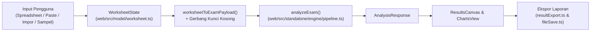

# Panduan Pengembang (Developer Manual) Itemetri

Dokumen ini menjadi rujukan teknis untuk memahami arsitektur, menavigasi struktur kode, menambah atau mengubah fitur, memvalidasi perubahan, serta menangani kegagalan pada **Itemetri**.

---

## Daftar Isi

- [1. Understand: Arsitektur dan Cara Kerja](#1-understand-arsitektur-dan-cara-kerja)
  - [1.1 Gambaran Umum Arsitektur](#11-gambaran-umum-arsitektur)
  - [1.2 Alur Data Utama (End-to-End)](#12-alur-data-utama-end-to-end)
  - [1.3 Model Lembar Kerja dan Penyatuan PG + Uraian](#13-model-lembar-kerja-dan-penyatuan-pg--uraian)
  - [1.4 Mesin Psikometri Mode Ganda](#14-mesin-psikometri-mode-ganda)
  - [1.5 Kompilasi Panduan Pengguna Terintegrasi](#15-kompilasi-panduan-pengguna-terintegrasi)
- [2. Locate: Struktur Kode dan Peta Modul](#2-locate-struktur-kode-dan-peta-modul)
  - [2.1 Struktur Direktori Proyek](#21-struktur-direktori-proyek)
  - [2.2 Peta Lokasi Cepat](#22-peta-lokasi-cepat)
  - [2.3 Rincian Modul Utama](#23-rincian-modul-utama)
- [3. Modify: Alur Kerja Mengubah dan Menambah Fitur](#3-modify-alur-kerja-mengubah-dan-menambah-fitur)
  - [3.1 Menyiapkan Lingkungan Pengembangan](#31-menyiapkan-lingkungan-pengembangan)
  - [3.2 Skenario Perubahan yang Umum](#32-skenario-perubahan-yang-umum)
  - [3.3 Standar Pengembangan dan Kebersihan Kode](#33-standar-pengembangan-dan-kebersihan-kode)
- [4. Validate: Memastikan Perubahan Tidak Merusak Fitur Lain](#4-validate-memastikan-perubahan-tidak-merusak-fitur-lain)
  - [4.1 Menjalankan Unit Test (`npm test`)](#41-menjalankan-unit-test-npm-test)
  - [4.2 Pemeriksaan Tipe dan Build Produksi (`npm run build`)](#42-pemeriksaan-tipe-dan-build-produksi-npm-run-build)
  - [4.3 Daftar Periksa Uji Manual di Peramban](#43-daftar-periksa-uji-manual-di-peramban)
- [5. Recover: Menangani Kegagalan dan Memulihkan Aplikasi](#5-recover-menangani-kegagalan-dan-memulihkan-aplikasi)
  - [5.1 Penanganan Galat di Runtime](#51-penanganan-galat-di-runtime)
  - [5.2 Kegagalan Build, Tes, atau Cache](#52-kegagalan-build-tes-atau-cache)
  - [5.3 Pemulihan Perubahan melalui Git](#53-pemulihan-perubahan-melalui-git)

---

## 1. Understand: Arsitektur dan Cara Kerja

### 1.1 Gambaran Umum Arsitektur

Itemetri berjalan sebagai aplikasi web **client-side murni** berbasis React 19 dan TypeScript (`web/`). Seluruh pembacaan berkas (`.ana`, `.csv`, `.xlsx`), penyekoran, perhitungan psikometri Teori Tes Klasik (CTT), pembuatan grafik SVG, hingga ekspor laporan (`.pdf`, `.xlsx`, `.txt`, `.png`, `.jpg`) berlangsung langsung di memori peramban pengguna tanpa memanggil API backend, WebAssembly, maupun CDN eksternal.

Keputusan arsitektur ini memberikan dua dampak langsung bagi pengembang:

1. **Tidak ada server API di runtime.** Fasad `web/src/api/client.ts` mengekspor ulang seluruh fungsi dari `web/src/standalone/client.ts`. Antarmuka React memanggil fungsi asinkron seolah berkomunikasi dengan server, padahal seluruh eksekusi berjalan lokal di TypeScript.
2. **Distribusi berupa berkas statis.** Hasil build (`web/dist/`) dapat langsung dipasang di peladen statis mana pun (GitHub Pages, Cloudflare Pages, atau cPanel) tanpa konfigurasi runtime server.

### 1.2 Alur Data Utama (End-to-End)



Alur eksekusi di dalam aplikasi mengikuti urutan berikut:

1. **Masuknya data:** Pengguna mengetik langsung di `JamoviSpreadsheet`, menempel dari Excel (`smartPasteWorksheet` / `pasteWorksheetBlock`), memuat sampel bawaan (`samples.ts`), atau mengimpor berkas melalui `ImportMapperDialog` dan modul I/O (`tabular.ts`, `xlsxZip.ts`, `xmlAna.ts`).
2. **Kompilasi lembar kerja:** `App.tsx` menyimpan riwayat lembar kerja di dalam hook `useUndoRedo`. Setiap kali `worksheet` berubah, `worksheetToExamPayload()` mengonversi baris dan kolom menjadi `ExamPayload` sekaligus memeriksa apakah ada butir soal yang belum memiliki kunci atau skor ideal (`missingKeyItemNumbers`).
3. **Gerbang kunci kosong:** Jika `missingKeyItemNumbers` tidak kosong, UI menahan eksekusi `analyzeExam()` dan menampilkan kartu peringatan agar butir tanpa kunci tidak dinilai sebagai jawaban `A` secara diam-diam.
4. **Pipeline analisis:** Setelah kunci lengkap, `App.tsx` memanggil `analyzeExam(exam, options)` di `web/src/standalone/engine/pipeline.ts`. Fungsi ini menjalankan tahapan berurutan:
   - `scoreMultipleChoice` / `scoreEssay` (penyekoran dan validasi awal)
   - `splitUpperLower` (pemisahan kelompok Unggul dan Asor)
   - `computeMcDiscrimination` / `computeEssayDiscrimination` (daya pembeda)
   - `computeMcDifficulty` / `computeEssayDifficulty` (tingkat kesukaran)
   - `computeItemCorrelations` (korelasi butir-total mentah, terkoreksi, dan alpha jika dihapus)
   - `computeDistractors` (khusus PG, analisis pengecoh)
   - `computeMcReliability` / `computeEssayReliability` (Spearman-Brown, Alpha Cronbach, KR-20, KR-21)
   - `evaluateItemVerdicts` (keputusan `Terima`, `Revisi`, `Tolak`, serta dugaan salah kunci)
   - `computeScoreDistributionSummary` & `computeExecutiveSummary` (ringkasan eksekutif, skewness, IQR, ketuntasan KKM)
   - `computeIndicatorSummary` (rekap penguasaan per indikator atau tujuan pembelajaran)
5. **Penyajian dan ekspor:** `ResultsCanvas.tsx` merender hasil `AnalysisResponse` ke kartu laporan bergaya APA dan grafik SVG (`ChartsView.tsx`, `ItemQualityMatrix.tsx`). Setiap kartu maupun laporan lengkap dapat diekspor melalui `CardExportBar.tsx`, `resultExport.ts`, dan `fileSave.ts`.

### 1.3 Model Lembar Kerja dan Penyatuan PG + Uraian

`WorksheetState` (`web/src/model/worksheet.ts`) memodelkan tabel fleksibel berukuran awal 15 baris x 10 kolom, dengan setiap kolom memiliki `kindMode` (`"auto"`, `"multiple_choice"`, atau `"essay"`), `answerKey`, `idealScore`, dan `indicator`.

Ketika seluruh kolom aktif bertipe Pilihan Ganda, `worksheetToExamPayload()` menghasilkan `ExamPayload` dengan `kind: "multiple_choice"`. Jika terdapat minimal satu kolom bertipe Uraian (termasuk lembar kerja campuran `PG + Uraian`), fungsi ini menyatukan keduanya ke dalam `kind: "essay"`: butir PG dikonversi menjadi skor dikotomi (`1` jika benar, `0` jika salah/kosong) dengan `ideal_scores` bernilai `1`, sementara butir Uraian memakai skor numerik dan skor ideal masing-masing.

### 1.4 Mesin Psikometri Mode Ganda

`AnalysisOptions.mode` mendukung dua perilaku perhitungan yang dapat dibandingkan secara langsung lewat `compareModes()` (`web/src/standalone/engine/comparison.ts`):

- **`standard_corrected` (bawaan):** Menggunakan presisi `float64`, derajat bebas eksak `df = N - 2` pada uji-$t$ korelasi, koreksi Welch-Satterthwaite untuk soal uraian, serta rentang kategori tingkat kesukaran tanpa celah.
- **`legacy_anates`:** Mereproduksi perilaku historis perangkat lunak ANATES lama (termasuk *banker's rounding* pada kelompok 27% dan tabel nilai kritis korelasi 14 baris `LEGACY_CORRELATION_TABLE`) untuk keperluan audit arsip berkas `.ana`/`.ANA`.

### 1.5 Kompilasi Panduan Pengguna Terintegrasi

Berkas [USER_MANUAL.md](USER_MANUAL.md) di akar proyek tidak disajikan mentah, melainkan dikompilasi oleh plugin Vite `userManualVitePlugin()` di [buildUserManual.mjs](web/scripts/buildUserManual.mjs). Plugin ini memakai `marked` dan `katex` (khusus di `devDependencies` agar tidak masuk ke bundle React utama) untuk menghasilkan halaman HTML statis mandiri dengan rumus MathML di `web/dist/user_manual/index.html` dan `web/dist/user_manual.html` (siap *Pretty URLs* di Cloudflare Pages).

---

## 2. Locate: Struktur Kode dan Peta Modul

### 2.1 Struktur Direktori Proyek

```text
Itemetri/
├── assets/                   # Ikon dan aset merek (itemetri.svg, dll.)
├── web/                      # Kode sumber utama aplikasi web Itemetri
│   ├── scripts/              # Skrip build (buildUserManual.mjs)
│   ├── src/
│   │   ├── api/              # Fasad API (client.ts -> standalone/client.ts)
│   │   ├── components/       # Komponen React antarmuka pengguna
│   │   ├── hooks/            # React hooks (useTheme, useUndoRedo, useVirtualGrid)
│   │   ├── model/            # Model state spreadsheet & kompilasi payload (worksheet.ts)
│   │   ├── standalone/       # Mesin hitung CTT murni & parser/eksportir berkas
│   │   │   ├── engine/       # Modul perhitungan statistik dan psikometri
│   │   │   └── io/           # Parser/eksportir .ana, .csv, .xlsx, dan deteksi encoding
│   │   ├── styles/           # Token desain, gaya dasar, dan gaya workspace
│   │   ├── utils/            # Utilitas clipboard, validasi sel, simpan file, dan ekspor
│   │   ├── App.tsx           # State utama aplikasi & orkestrasi alur kerja
│   │   ├── main.tsx          # Entry point React & pemuatan CSS
│   │   └── types.ts          # Definisi tipe TypeScript bersama
│   ├── tests/                # Pengujian otomatis (run_tests.mjs)
│   ├── package.json          # Skrip npm dan dependensi
│   └── vite.config.ts        # Konfigurasi Vite + userManualVitePlugin
├── CHANGELOG.md              # Riwayat perubahan tiap rilis
├── DESIGN.md                 # Arah desain visual dan token warna WCAG AA
├── DEVELOPER_MANUAL.md       # Dokumen ini
├── LICENSE                   # Lisensi MIT
├── README.md                 # Ringkasan proyek dan perintah dasar
└── USER_MANUAL.md            # Sumber markdown Panduan Pengguna
```

Direktori keluaran lokal seperti `web/node_modules/`, `web/dist/`, dan `build/` dikecualikan dari Git melalui `.gitignore` karena dibuat ulang secara otomatis saat instalasi dependensi, build, maupun pengujian.

### 2.2 Peta Lokasi Cepat

Gunakan tabel ini untuk menemukan berkas yang tepat sebelum mulai membaca atau menyunting kode.

| Kebutuhan Pengembang | Berkas Tujuan |
| :--- | :--- |
| Mengubah state global, handler impor/ekspor, atau tata letak split-pane | [App.tsx](web/src/App.tsx) |
| Mengubah struktur data tabel, *smart paste*, atau konversi ke `ExamPayload` | [worksheet.ts](web/src/model/worksheet.ts) |
| Menambah/mengubah tipe data `ExamPayload`, `AnalysisResponse`, atau opsi | [types.ts](web/src/types.ts) |
| Mengubah urutan pipeline analisis atau menambah ringkasan baru | [pipeline.ts](web/src/standalone/engine/pipeline.ts) |
| Mengubah rumus reliabilitas, daya pembeda, kesukaran, atau korelasi | `web/src/standalone/engine/` (`reliability.ts`, `discrimination.ts`, `difficulty.ts`, `correlation.ts`) |
| Mengubah aturan keputusan butir (`Terima`/`Revisi`/`Tolak`) atau dugaan salah kunci | [verdict.ts](web/src/standalone/engine/verdict.ts) |
| Mengubah analisis Pretest-Posttest (N-Gain & uji-$t$ berpasangan) | [pretestPosttest.ts](web/src/standalone/engine/pretestPosttest.ts) & [PretestPosttestModal.tsx](web/src/components/PretestPosttestModal.tsx) |
| Mengubah pembacaan/penulisan `.xlsx` dan `.csv` atau daftar kolom yang diabaikan | [tabular.ts](web/src/standalone/io/tabular.ts) & [xlsxZip.ts](web/src/standalone/io/xlsxZip.ts) |
| Mengubah parser/eksportir `.ana` XML | [xmlAna.ts](web/src/standalone/io/xmlAna.ts) |
| Mengubah pita aksi atas (Ribbon) atau menu alat lanjutan | [JamoviRibbon.tsx](web/src/components/JamoviRibbon.tsx) |
| Mengubah kanvas spreadsheet dan virtualisasi baris/kolom | [JamoviSpreadsheet.tsx](web/src/components/JamoviSpreadsheet.tsx) & [useVirtualGrid.ts](web/src/hooks/useVirtualGrid.ts) |
| Mengubah tampilan kartu hasil analisis atau filter keputusan | [ResultsCanvas.tsx](web/src/components/ResultsCanvas.tsx) & [ItemQualityMatrix.tsx](web/src/components/ItemQualityMatrix.tsx) |
| Mengubah ekspor PDF, Word HTML, teks APA, atau Excel laporan | [resultExport.ts](web/src/utils/resultExport.ts) & [fileSave.ts](web/src/utils/fileSave.ts) |
| Mengubah warna, tipografi, atau tampilan mode Terang/Gelap | [tokens.css](web/src/styles/tokens.css), [workspace.css](web/src/styles/workspace.css), & [useTheme.ts](web/src/hooks/useTheme.ts) |
| Mengubah kompilasi HTML halaman `? Panduan` | [buildUserManual.mjs](web/scripts/buildUserManual.mjs) |
| Menambah atau memeriksa unit test | [run_tests.mjs](web/tests/run_tests.mjs) |

### 2.3 Rincian Modul Utama

- **Mesin Psikometri (`web/src/standalone/engine/`):**
  - `math.ts`: Fungsi matematika dasar (`lnGamma`, `regularizedIncompleteBeta`, `studentTTwoTailedP`, `roundHalfToEven`, `bankerRoundGroupSize`, `pearson1d`, `pearsonMatrixVector`, `sanitizeNum`). `sanitizeNum()` memastikan nilai `NaN` atau `Infinity` dikonversi menjadi `null` agar aman diserialisasi.
  - `scoring.ts`: Penyekoran PG (`scoreMultipleChoice`), Uraian (`scoreEssay`), serta validasi struktur ujian (`validateMultipleChoiceExam`, `validateEssayExam`).
  - `upperLower.ts`, `discrimination.ts`, `difficulty.ts`, `correlation.ts`, `distractor.ts`, `reliability.ts`: Modul perhitungan CTT yang berdiri sendiri dan bebas ketergantungan DOM.
  - `summary.ts` & `indicators.ts`: Menghasilkan narasi ringkasan eksekutif, statistik distribusi skor, dan ringkasan penguasaan indikator.
  - `merge.ts`: Menggabungkan dua berkas ujian berdasarkan sumbu peserta atau sumbu butir soal (`mergeExams`), melempar `StandaloneDomainError` jika struktur tidak cocok.
  - `samples.ts`: Menyediakan daftar dan isi sampel simulasi bawaan (`BUILTIN_SAMPLE_LIST`, `getBuiltinSample`).

- **Lapisan I/O (`web/src/standalone/io/`):**
  - `encoding.ts`: Mendeteksi BOM UTF-8, UTF-16LE/BE, atau fallback `windows-1252` (`decodeBytes`), serta mendefinisikan `StandaloneParseError` (status `422`, `code: "parse_error"`).
  - `xlsxZip.ts`: Pembaca dan penulis `.xlsx` murni menggunakan `DecompressionStream`/`CompressionStream` bawaan Web API tanpa pustaka pihak ketiga eksternal.
  - `tabular.ts`: Pratinjau pemetaan kolom (`previewTabularBytes`), deteksi otomatis kolom metadata Google Forms/LMS (`Timestamp`, `Email Address`, `Score`, `NISN`, `Kelas`, dll.), pembacaan desimal koma lokal Indonesia, serta pembuatan template `.xlsx`.
  - `xmlAna.ts`: Pemindai token XML untuk `.ana`/`.ANA` yang mendukung `<![CDATA[...]]>` dan atribut berisi `>`.

- **Utilitas dan Hooks (`web/src/utils/`, `web/src/hooks/`):**
  - `clipboard.ts`: Normalisasi angka desimal koma Indonesia (`parseLocalizedNumber`, `parseLocalizedNumberList`) dan pemrosesan teks tempel dari Excel.
  - `validation.ts`: Validasi sel secara langsung (`validateMcCell`, `validateEssayCell`) saat pengguna mengetik di spreadsheet.
  - `fileSave.ts`: Abstraksi penyimpanan berkas `saveBlobWithDialog()` yang memilih dialog desktop `window.pywebview.api.save_file` (jika tersedia), `window.showSaveFilePicker` pada peramban Chromium, atau fallback `<a download>`.
  - `useTheme.ts`: Mengelola preferensi tema (`light`, `dark`, `system`) pada `localStorage["itemetri-color-scheme"]`.

---

## 3. Modify: Alur Kerja Mengubah dan Menambah Fitur

### 3.1 Menyiapkan Lingkungan Pengembangan

Prasyarat utama adalah **Node.js versi 18 atau lebih baru** beserta `npm`.

```powershell
cd web
npm ci
npm run dev
```

Server pengembangan Vite akan aktif beserta kompilasi langsung halaman panduan di jalur `./user_manual/`.

### 3.2 Skenario Perubahan yang Umum

**Skenario A: Menambah metrik atau analisis statistik baru**
1. Tambahkan properti tipe hasil pada antarmuka yang relevan di `web/src/types.ts` (misalnya di dalam `AnalysisResponse`).
2. Implementasikan fungsi perhitungan murni (tanpa dependensi DOM/React) di `web/src/standalone/engine/`. Pastikan setiap angka keluaran melewati `sanitizeNum()` agar `NaN`/`Infinity` berubah menjadi `null`.
3. Panggil fungsi baru tersebut di `analyzeMultipleChoice()` dan/atau `analyzeEssay()` pada `web/src/standalone/engine/pipeline.ts`.
4. Tampilkan hasilnya di `web/src/components/ResultsCanvas.tsx`, dan perbarui builder ekspor di `web/src/utils/resultExport.ts` jika metrik tersebut perlu masuk ke laporan PDF/Word/XLSX.
5. Tambahkan kasus uji di `web/tests/run_tests.mjs`.

**Skenario B: Menambah dialog, kontrol Ribbon, atau komponen UI**
1. Gunakan komponen `ModalFrame` dari `web/src/components/Dialogs.tsx` untuk setiap dialog baru agar terbuka di *Top Layer* (`dialog.showModal()`) dan tidak tertimpa header tabel spreadsheet yang memakai `position: sticky`.
2. Gunakan variabel warna dari `web/src/styles/tokens.css` (seperti `--bg-subtle`, `--accent`, `--err`, `--err-bg`) agar kontras WCAG AA di mode Terang dan Gelap tetap terjaga.
3. Jangan memakai ikon dekoratif atau emoji di antarmuka; tambahkan ikon SVG fungsional di `web/src/components/Icons.tsx` dengan `aria-hidden="true"`.

**Skenario C: Mengubah parser atau eksportir berkas**
1. Jika menambah dukungan baca berkas di `web/src/standalone/io/`, gunakan `StandaloneParseError` untuk galat format agar UI dapat menampilkan pesan yang jelas.
2. Jika menambah ekspor `.csv` atau `.xlsx`, pastikan seluruh sel string melewati sanitasi *formula injection* (memberi prefiks `'` pada sel yang diawali `=`, `+`, `-`, `@`, `\t`, atau `\r`) seperti yang diterapkan di `tabular.ts`.
3. Jika menghasilkan output HTML (misalnya untuk ekspor Word), selalu escape karakter khusus HTML (`&`, `<`, `>`, `"`) seperti di `resultExport.ts`.

### 3.3 Standar Pengembangan dan Kebersihan Kode

1. **Ketat pada TypeScript dan nol dependensi eksternal runtime:** `tsc --noEmit` harus lolos tanpa error. Hindari menambah pustaka yang memuat skrip dari CDN eksternal karena aplikasi dirancang lolos kebijakan CSP `'self'`.
2. **Patuhi arah desain di `DESIGN.md`:** Pertahankan tata letak *split-pane*, dial `ENERGY 1 / RHYTHM 2 / MOTION 1`, dan gunakan angka `tabular-nums` untuk kolom metrik.
3. **Bebas karakter *em dash* dan *en dash*:** Pengujian otomatis di `web/tests/run_tests.mjs` memindai kode sumber `web/src/`, `USER_MANUAL.md`, dan `DESIGN.md` untuk memastikan nol karakter *em dash* (`\u2014`) dan *en dash* (`\u2013`). Gunakan tanda koma, titik dua, tanda kurung, atau `s.d.` sebagai pengganti.
4. **Pembaruan dokumentasi:** Setelah mengubah perilaku fitur yang terlihat pengguna, perbarui [CHANGELOG.md](CHANGELOG.md) dan [USER_MANUAL.md](USER_MANUAL.md) (jika relevan).

---

## 4. Validate: Memastikan Perubahan Tidak Merusak Fitur Lain

### 4.1 Menjalankan Unit Test (`npm test`)

Jalankan perintah berikut di direktori `web/`:

```powershell
cd web
npm test
```

Skrip `web/tests/run_tests.mjs` menggunakan `esbuild` untuk mengompilasi modul TypeScript ke `build/web_tests/` lalu menjalankan 15 kasus uji menggunakan `node:test`. Cakupan pengujian meliputi:
- Model lembar kerja (`createBlankWorksheet`, `pasteWorksheetBlock`, `smartPasteWorksheet`, kompilasi `PG + Uraian`, serta gerbang `missingKeyItemNumbers`).
- Keamanan dan batas I/O (`xlsxZip` menolak `.xls` lama dan ZIP korup, pembatasan referensi kolom ekstrem, `xmlAna` menangani CDATA dan menolak `DOCTYPE`, serta sanitasi *formula injection* pada CSV/XLSX).
- Pipeline analisis (`executive_summary`, `score_distribution`, `verdict` checks, `indicator_summary`, serta `pretestPosttest` N-Gain dan uji-$t$ berpasangan).
- Normalisasi papan klip desimal koma Indonesia, pembangkitan template & laporan `.xlsx`, kompilasi `buildUserManualHtml` (MathML KaTeX dan keutuhan seluruh *anchor* internal), serta pemindaian nol *em dash*/*en dash*.

### 4.2 Pemeriksaan Tipe dan Build Produksi (`npm run build`)

```powershell
cd web
npm run build
```

Perintah ini menjalankan `tsc --noEmit` diikuti `vite build`. Pastikan kedua langkah selesai dengan kode keluar `0` dan menghasilkan `web/dist/index.html` serta `web/dist/user_manual/index.html` tanpa peringatan tipe atau kegagalan kompilasi KaTeX.

### 4.3 Daftar Periksa Uji Manual di Peramban

Setelah `npm run build`, jalankan `npm run preview` untuk memverifikasi alur yang tidak terjangkau oleh tes Node:
1. Uji muat sampel bawaan dan tempel data langsung dari Excel (termasuk angka desimal koma).
2. Pastikan kartu hasil muncul seketika, tombol `? Panduan` membuka `/user_manual/` tanpa tautan rusak, dan perpindahan tema Terang/Gelap tetap terbaca jelas.
3. Periksa tata letak Ribbon pada lebar layar sempit (`375px`) agar tombol tidak saling bertumpuk.
4. Uji minimal satu aksi ekspor laporan (`.pdf` atau `.xlsx`) untuk memastikan `fileSave.ts` berjalan normal.

---

## 5. Recover: Menangani Kegagalan dan Memulihkan Aplikasi

### 5.1 Penanganan Galat di Runtime

Aplikasi memisahkan kegagalan menjadi beberapa lapisan agar mudah dilacak dan dipulihkan tanpa membuat antarmuka macet:

- **Galat parsing berkas dan domain:** Modul I/O melempar `StandaloneParseError` (status `422`), sedangkan `merge.ts` melempar `StandaloneDomainError`. Fungsi `toApiError()` di `web/src/standalone/client.ts` menyeragamkan keduanya menjadi `ApiError` agar `App.tsx` dapat menampilkannya pada state `errorMsg` tanpa menjatuhkan aplikasi.
- **Batas perlindungan memori dan ukuran berkas:**
  - `standalone/client.ts` menolak unggahan di atas `20 MB` (`MAX_UPLOAD_BYTES`) dengan status `413`.
  - `xlsxZip.ts` membatasi ukuran dekompresi maksimal `50 MB` serta batas dimensi lembar kerja `50.000` baris dan `5.000` kolom. Jika berkas pengguna melampaui batas ini atau berformat `.xls` biner lama, sistem menghentikan pembacaan lebih awal dan mengembalikan pesan pemulihan yang meminta pengguna menyimpan ulang ke `.xlsx` atau `.csv`.
- **Galat input sel dan kunci kosong:** `validateMcCell()` dan `validateEssayCell()` (`web/src/utils/validation.ts`) memberi peringatan baris per sel tanpa menghapus isi sel pengguna, sehingga pengguna dapat langsung mengoreksi angka/huruf yang keliru.
- **Pembatalan dialog simpan:** `saveBlobWithDialog()` (`web/src/utils/fileSave.ts`) menangkap `AbortError` saat pengguna menutup dialog `showSaveFilePicker` dan mengembalikan `{ saved: false, cancelled: true }` sehingga tidak dianggap sebagai galat.
- **Pemulihan tema yang korup:** `useTheme.ts` membaca `localStorage["itemetri-color-scheme"]`. Jika nilainya tidak valid atau akses penyimpanan diblokir, aplikasi kembali ke mode bawaan sistem tanpa error.

### 5.2 Kegagalan Build, Tes, atau Cache

- **Build gagal pada `userManualVitePlugin`:** Biasanya disebabkan oleh sintaks LaTeX yang tidak valid di `USER_MANUAL.md` (karena `katex` diatur `throwOnError: true` di `buildUserManual.mjs`) atau tautan *anchor* Daftar Isi yang tidak cocok dengan judul bab. Periksa pesan baris galat pada log Vite, perbaiki `USER_MANUAL.md`, lalu jalankan ulang `npm test` dan `npm run build`.
- **Hasil `npm test` tidak mencerminkan perubahan terbaru atau folder `build/web_tests/` bermasalah:** Hapus direktori sementara `build/web_tests/` dan `web/dist/`, lalu jalankan ulang pengujian:

```powershell
Remove-Item -Recurse -Force build\web_tests, web\dist -ErrorAction SilentlyContinue
cd web
npm test
```

- **Dependensi Node korup setelah pindah cabang Git:** Jalankan `npm ci` di dalam `web/` untuk memulihkan `node_modules` sesuai `package-lock.json`.

### 5.3 Pemulihan Perubahan melalui Git

Jika perubahan merusak fitur utama dan perlu dikembalikan cepat, gunakan Git untuk mengisolasi dan memulihkan berkas yang bermasalah sebelum melanjutkan:

```powershell
# Memeriksa berkas yang berubah
git status

# Mengembalikan satu berkas ke kondisi commit terakhir
git checkout -- web/src/path/ke/file.ts
```
